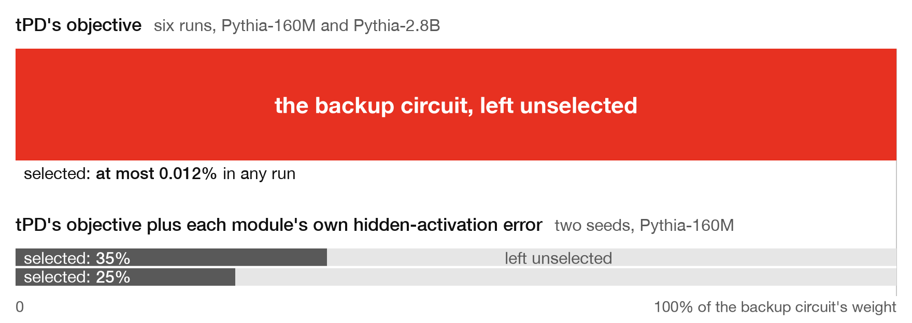

# tPD leaves a backup in Δ on the prompts that need it

**A backup circuit alone answered six of [tPD](https://arxiv.org/abs/2607.13047)'s target prompts, and tPD selected at most 0.012% of its weight.** That held in six runs of six, on Pythia-160M and Pythia-2.8B with the backup built in. Adding each module's own hidden-activation error to the loss found it at 160M: 35% and 25% of its weight, and ablating them silenced it on all six prompts.

The paper warns that a mechanism can be missed when "the original model's behavior could be recreated using only a fraction of the relevant mechanisms". Not here: without the backup the model answers the six prompts with probability below 0.012. With it, 0.23 to 0.92.

What tPD does not select, its ablation does not remove: in five of the six runs the backup still pushes ` pd` afterwards. In the sixth, a second decomposition selected one output direction, under 0.01% of the backup's weight, and that silenced it.

**The backup** is two units after the last block, one for numpy, one for pandas. A detector fires on `pandas as`, a gate shuts it off when the model itself already answers ` pd`, and an output writes ` pd`: silent on `import pandas as`, alone in answering `of pandas as`. tPD decomposes its three matrices with the model's.

**The loss.** Each decomposed module, fed its own clean input, must reproduce its clean output from its masked subcomponents and Δ: squared error relative to the output's mean square, averaged over modules, at weight 100. A module left in Δ then costs something whatever the rest does.

**The runs.** The paper's 4-block numpy/pandas recipe, with the adversary on from 20% (160M) or 50% (2.8B) of training, on its two prompts and the backup's six.

| Pythia | seed | CI network | loss | weight selected | push before | push after | answer after |
|---|---|---|---|---|---|---|---|
| 160M | 0 | global | tPD's | 0.002% | 7.3 to 11.5 | 8.5 to 14.1 | 0.92 |
| 160M | 1 | global | tPD's | 0.000% | 7.3 to 11.5 | 7.5 to 16.2 | 0.08 |
| 160M | 0 | per module | tPD's | 0.002% | 7.3 to 11.5 | 6.0 to 12.5 | 0.00 |
| 160M | 1 | per module | tPD's | 0.007% | 7.3 to 11.5 | 0 | 0.00 |
| 2.8B | 0 | per module | tPD's | -0.001% | 5.6 to 7.0 | 3.5 to 7.4 | 0.00 |
| 2.8B | 1 | per module | tPD's | 0.012% | 5.6 to 7.0 | 5.7 to 12.9 | 0.08 |
| 160M | 0 | per module | tPD's + hidden | 35% | 7.3 to 11.5 | 0 | 0.00 |
| 160M | 1 | per module | tPD's + hidden | 25% | 7.3 to 11.5 | 0 | 0.00 |
| 2.8B † | 0 | per module | tPD's | 1.2% | 17.1 to 21.5 | 12.6 to 17.2 | 0.82 |
| 2.8B † | 0 | per module | tPD's + hidden | 30% | 17.1 to 21.5 | 0 | 0.00 |

Weight selected is by squared norm over the backup's three matrices. Push is the backup's own contribution to the logit of ` pd` on its six prompts. Answer after is the highest probability of ` pd` there once the selection is ablated. At 2.8B the backup's output is scaled down until it no longer saturates. † Full-strength backup and the paper's two prompts only: no target prompt needs it.

`python check.py` recomputes every number here from `results/` and redraws the figure.
